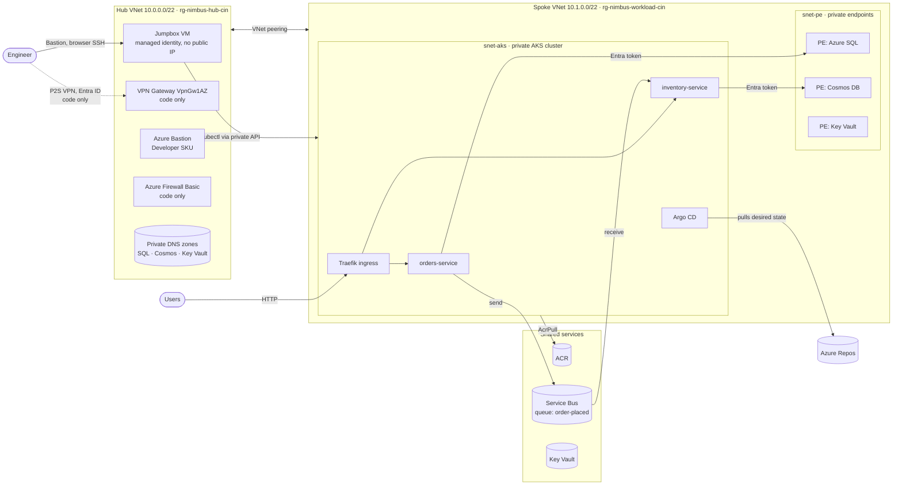

# Nimbus: Azure Enterprise Platform (Hub-and-Spoke · Private AKS · GitOps · DevSecOps)

**Nimbus** is a production-style Azure platform built end to end with Terraform, Helm, Argo CD and Azure Pipelines.
It runs an event-driven microservice application (orders + inventory) on a **private AKS cluster** inside a
**hub-and-spoke network**. Every data service sits behind a **private endpoint**, and every component authenticates with
**Entra ID and managed / workload identities**: there are **no passwords, keys or connection strings** anywhere in Azure.

> **Status:** The core platform was **deployed to Azure and verified end to end** (October 2026, Azure free trial).
> After the trial ended, the subscription was disabled. The firewall, VPN and DR components are **implemented as
> Terraform modules and validated in CI, but were not deployed** (cost). See [What was deployed](#what-was-deployed-vs-implemented-as-code).

---

## Table of contents

- [Architecture](#architecture)
- [What was deployed vs implemented as code](#what-was-deployed-vs-implemented-as-code)
- [The application](#the-application)
- [Repository structure](#repository-structure)
- [Infrastructure as Code (Terraform)](#infrastructure-as-code-terraform)
- [Security model](#security-model)
- [Delivery: GitOps with Argo CD](#delivery-gitops-with-argo-cd)
- [CI/CD: Azure Pipelines](#cicd-azure-pipelines)
- [Cost and FinOps](#cost-and-finops)
- [Design decisions and trade-offs](#design-decisions-and-trade-offs)
- [Problems solved along the way](#problems-solved-along-the-way)
- [How to run it](#how-to-run-it)
- [Tech stack and versions](#tech-stack-and-versions)

---

## Architecture



**Request flow:** `PUT /inventory` → Cosmos DB · `POST /orders` → Azure SQL → event on Service Bus → inventory-service
consumes it and decrements stock in Cosmos DB. Verified in Azure: stock **50 → order 3 → 47**.

**Access paths into the private network:**

| Path                                          | Used for                                                                  |
| --------------------------------------------- | ------------------------------------------------------------------------- |
| Azure Bastion (Developer SKU, free) → jumpbox | Interactive admin: `kubectl`, `helm`, `sqlcmd`                            |
| `az aks command invoke`                       | One-off `kubectl` commands through the Azure API (no network path needed) |
| Point-to-site VPN (Entra ID)                  | Implemented as code, not deployed                                         |

---

## What was deployed vs implemented as code

| Area              | Component                                                                                                                       | Status                                                          |
| ----------------- | ------------------------------------------------------------------------------------------------------------------------------- | --------------------------------------------------------------- |
| Governance        | Azure Policy (allowed regions, allowed VM sizes, custom tag-audit policy), budget alerts                                        | ✅ Deployed & verified (`RequestDisallowedByPolicy` tested)     |
| Network           | Hub-and-spoke VNets, subnets, NSGs, peering, private DNS zones                                                                  | ✅ Deployed & verified                                          |
| Compute           | Private AKS 1.35 (Azure CNI Overlay, Entra ID + Azure RBAC, local accounts disabled)                                            | ✅ Deployed & verified                                          |
| Data              | Azure SQL (Entra-only auth), Cosmos DB (keys disabled), Service Bus (keys disabled), all via private endpoints or identity-only | ✅ Deployed & verified                                          |
| Identity          | Workload identity per service (federated credentials), least-privilege role assignments                                         | ✅ Deployed & verified                                          |
| Admin access      | Jumpbox VM with its own managed identity + Azure Bastion                                                                        | ✅ Deployed & verified                                          |
| Delivery          | Helm chart, Argo CD app-of-apps, Traefik ingress, self-healing                                                                  | ✅ Deployed & verified                                          |
| CI                | Azure Pipelines: tests, Helm lint, Checkov, Trivy, Gitleaks, Terraform validate                                                 | ✅ Running on every push                                        |
| CD                | Pipeline stages for `terraform plan → approval → apply` and image push → GitOps release                                         | 🟡 Implemented, gated behind a `deploy` parameter, not executed |
| Network security  | Azure Firewall (Basic) with FQDN allow-list + route table                                                                       | 🟡 Terraform module, validated, `enable_firewall = false`       |
| Remote access     | P2S VPN gateway (OpenVPN, Entra ID auth)                                                                                        | 🟡 Terraform module, validated, `enable_vpn = false`            |
| Disaster recovery | SQL failover group, Cosmos DB second region, DR spoke in South India + global peering                                           | 🟡 Terraform module, validated, `enable_dr = false`             |

Infrastructure was deployed with the **Terraform CLI** while building; the same flow was then codified into the gated
pipeline stages.

---

## The application

Two Python (FastAPI) microservices, each owning its own data store:

| Service             | Data                                                | Endpoints                                   | Events                          |
| ------------------- | --------------------------------------------------- | ------------------------------------------- | ------------------------------- |
| `orders-service`    | Azure SQL (`ordersdb.dbo.orders`)                   | `POST/GET /orders`, `GET /orders/{id}`      | **Publishes** to `order-placed` |
| `inventory-service` | Cosmos DB (`nimbus/inventory`, partition key `/id`) | `GET /inventory`, `GET/PUT /inventory/{id}` | **Consumes** `order-placed`     |

- **One codebase, two auth modes:** locally the services use emulator credentials; in Azure they use
  `DefaultAzureCredential`, which picks up the pod's **workload identity**. No code change is needed between environments.
- **Health probes:** `/health` (liveness: process alive) and `/ready` (readiness: database reachable), so a database
  outage removes a pod from traffic without restarting it.
- **Resilience:** startup retries for databases, a reconnecting Service Bus consumer, and dead-lettering after 3 failed deliveries.
- **Containers:** multi-stage Dockerfiles (~210 MB), non-root user (UID 10001), no build tools in the final image.
- **Local development:** Docker Compose with Microsoft's official **SQL Server, Cosmos DB and Service Bus emulators**.

---

## Repository structure

```
.
├── app/
│   ├── orders-service/          # FastAPI + Azure SQL, Dockerfile, unit tests
│   ├── inventory-service/       # FastAPI + Cosmos DB, Dockerfile, unit tests
│   ├── local/                   # Service Bus emulator config
│   └── docker-compose.yml       # full local stack with emulators
├── infra/
│   ├── bootstrap/               # one-time script: Terraform state storage + provider registration
│   ├── modules/                 # 19 reusable for_each-driven modules
│   ├── environments/prod/       # composition: main.tf, variables.tf, terraform.tfvars, cloud-init
│   └── tools/tf-args.sh         # prints a resource's arguments from the installed provider schema
├── helm/microservice/           # one generic chart used by both services
├── deploy/                      # per-service values (image tag bumped by the release pipeline)
├── argocd/
│   ├── bootstrap/               # Argo CD install values
│   ├── root.yaml                # app-of-apps entry point
│   ├── apps/                    # Traefik, orders, inventory, Argo CD UI
│   └── manifests/argocd-ui/     # ingress + Traefik IP allow-list
├── pipelines/
│   ├── infra-pipeline.yml       # validate + scan; gated plan → approval → apply
│   ├── app-pipeline.yml         # test + scan + build; gated push → GitOps release
│   └── templates/               # reusable job / step templates
└── docs/runbooks/               # e.g. SQL user creation for workload identities
```

---

## Infrastructure as Code (Terraform)

- **Remote state** in Azure Storage with Entra ID auth (no storage keys), versioning and soft delete.
- **19 reusable modules**, each driven by `for_each` over maps, so adding a VNet, subnet, NSG rule, private
  endpoint or role assignment means **adding a map entry in `terraform.tfvars`**, not new resource code.
  Nested structures (VNets → subnets → NSG rules, accounts → databases → containers) are flattened with `merge([...]...)`.
- **Cost switches:** expensive components are toggled with `enable_firewall`, `enable_vpn` and `enable_dr`, using
  `{ for k, v in var.x : k => v if var.enable_x }`, so one boolean creates or removes a whole feature.
- **Ordering through data, not `depends_on`:** for example, the hub↔spoke peering sets `use_remote_gateways` from the VPN
  module's output, so Terraform always creates the gateway before updating the peering.
- **Provider:** `azurerm` **v5.0.0**. Several v4 → v5 argument renames were handled (see [Problems solved](#problems-solved-along-the-way)).

| Module                                          | Creates                                                                                                                                  |
| ----------------------------------------------- | ---------------------------------------------------------------------------------------------------------------------------------------- |
| `resource_group`, `network`, `route_table`      | Resource groups; VNets, subnets, NSGs + rules, peering (both directions); UDRs                                                           |
| `private_dns`, `private_endpoint`               | Central private DNS zones linked to all VNets; private endpoints with DNS zone groups                                                    |
| `acr`, `key_vault`                              | Registry (admin user disabled, AcrPush/AcrPull via RBAC); Key Vault (RBAC mode, firewall + private endpoint)                             |
| `sql`, `cosmos`, `service_bus`                  | Entra-only SQL server + DBs; Cosmos DB (keys disabled, multi-region capable); Service Bus namespace + queues (keys disabled)             |
| `aks`, `workload_identity`                      | Private AKS + identities/roles; per-service managed identity, federated credential, least-privilege roles (incl. Cosmos data-plane RBAC) |
| `vm`, `bastion`                                 | Jumpbox (managed identity, cloud-init, auto-shutdown); Bastion Developer                                                                 |
| `policy`, `budget`                              | Policy definitions/assignments; budgets with actual + forecast alerts                                                                    |
| `firewall`, `vpn_gateway`, `sql_failover_group` | Firewall + policy + rule collections; P2S VPN with Entra ID; SQL failover group                                                          |

---

## Security model

| Control                   | Implementation                                                                                                                                                               |
| ------------------------- | ---------------------------------------------------------------------------------------------------------------------------------------------------------------------------- |
| **No secrets**            | SQL is Entra-only (no SQL login exists); Cosmos DB and Service Bus have key auth disabled; ACR admin user disabled; AKS local accounts disabled                              |
| **Workload identity**     | Each pod's service account is federated to its own managed identity (`system:serviceaccount:nimbus:<service>`)                                                               |
| **Least privilege**       | orders: Service Bus _Sender_ on one queue + `db_datareader/datawriter/ddladmin`; inventory: Service Bus _Receiver_ on one queue + Cosmos _Data Contributor_ on one container |
| **Private data plane**    | SQL, Cosmos DB and Key Vault have public access disabled and are reached through private endpoints and private DNS                                                           |
| **Private control plane** | AKS API server has a private IP only; admin access through Bastion → jumpbox (managed identity, no human tokens stored on the VM)                                            |
| **Network segmentation**  | NSG on the private-endpoint subnet allows only AKS, jumpbox and VPN ranges on ports 443/1433, then denies all                                                                |
| **Governance**            | Azure Policy denies non-approved regions and VM sizes; audits missing tags                                                                                                   |
| **Pod hardening**         | Non-root, read-only root filesystem, no privilege escalation, all capabilities dropped, seccomp `RuntimeDefault`                                                             |
| **Supply chain**          | Trivy image scan (fails on fixable CRITICAL), Checkov for Terraform and rendered Kubernetes manifests, Gitleaks across full git history                                      |
| **Admin UI exposure**     | Argo CD UI behind a Traefik IP allow-list middleware                                                                                                                         |

---

## Delivery: GitOps with Argo CD

```
argocd/root.yaml  (applied once)
   └── watches argocd/apps/
         ├── traefik.yaml        → Traefik Helm chart 41.7.0 (public LoadBalancer)
         ├── orders.yaml         → helm/microservice + deploy/values-orders.yaml
         ├── inventory.yaml      → helm/microservice + deploy/values-inventory.yaml
         └── argocd-ui.yaml      → ingress + IP allow-list for the Argo CD UI
```

- **App of apps:** one manually applied `root` Application manages all others; adding an app = adding a file.
- **Automated sync with `prune` and `selfHeal`:** Git is the single source of truth. Verified by deleting the
  `orders-service` Deployment by hand; Argo CD recreated it within seconds.
- **One generic Helm chart** (ServiceAccount, Deployment, Service, HPA, Ingress) is reused for both services, with
  per-service values files.
- Argo CD reads the private Azure Repo with a read-only PAT stored as a Kubernetes secret
  (see [trade-offs](#design-decisions-and-trade-offs)).

---

## CI/CD: Azure Pipelines

Both pipelines run on Microsoft-hosted agents (`ubuntu-24.04`, pinned), with path filters so each runs only when its area changes.

**`infra-pipeline.yml`**

| Stage    | Runs                     | Steps                                                                                                  |
| -------- | ------------------------ | ------------------------------------------------------------------------------------------------------ |
| Validate | Every push               | `terraform fmt -check`, `init -backend=false`, `validate`; Checkov (results published as test results) |
| Plan     | `deploy=true`            | OIDC login (workload identity federation, no secrets) → `terraform plan` → plan saved as artifact      |
| Apply    | `deploy=true` + approval | Deployment job on the `prod` environment → applies **exactly the approved plan**                       |

**`app-pipeline.yml`**

| Stage   | Runs                     | Steps                                                                                                     |
| ------- | ------------------------ | --------------------------------------------------------------------------------------------------------- |
| Test    | Every push               | Unit tests for both services (matrix), Helm lint, Checkov on rendered manifests, Gitleaks on full history |
| Build   | Every push               | Per-service template: Docker build → Trivy scan (→ push to ACR when `deploy=true`)                        |
| Release | `deploy=true` + approval | Bumps image tags in `deploy/values-*.yaml` and pushes to Git (`[skip ci]`) → Argo CD deploys              |

The deploy stages are included with compile-time `${{ if eq(parameters.deploy, true) }}` expressions, so with the
default `deploy: false` they are not part of the run and need no subscription or service connection.

---

## Cost and FinOps

- **Total spend for the whole build: ₹909** (≈ US$11), about 5% of the trial credit.
- **Biggest steady cost was not compute:** the three **private endpoints** (~₹150 each over the period, ~₹20/day each,
  always on). AKS was stopped and the jumpbox deallocated whenever idle.
- **Cost controls built in:** budget alerts (25/50/75/100% actual + forecast), Azure Policy limiting VM sizes,
  jumpbox auto-shutdown at 23:00 IST, and `enable_*` switches keeping firewall (~₹35/h), VPN (~₹16/h) and DR off by default.
- Free tiers used where possible: AKS Free control plane, Cosmos DB free tier, Bastion Developer.

---

## Design decisions and trade-offs

| Decision                                                      | Reasoning                                                                                                                                                                  |
| ------------------------------------------------------------- | -------------------------------------------------------------------------------------------------------------------------------------------------------------------------- |
| **One spoke VNet with subnets** (not one VNet per tier)       | One spoke per workload is the standard hub-and-spoke pattern; tiers are separated by subnets + NSGs, and it avoids non-transitive spoke-to-spoke peering                   |
| **ACR Basic and Service Bus Basic without private endpoints** | Private endpoints require Premium SKUs (much higher cost). Mitigated with identity-only access (admin user / SAS keys disabled)                                            |
| **Key Vault public endpoint restricted by IP**                | Needed for admin access from a dynamic ISP range during the build; production would remove it and use VPN/jumpbox only. RBAC still applies                                 |
| **Firewall filters the jumpbox subnet, not AKS egress**       | Routing AKS egress through the firewall requires `outbound_type = userDefinedRouting` plus DNAT for ingress to avoid asymmetric routing; scoped to keep the module correct |
| **SQL users created from client ID (SID)**                    | `CREATE USER ... WITH SID = <client id>, TYPE = E` avoids giving the SQL server Directory Readers permission in Entra ID                                                   |
| **Traefik instead of ingress-nginx**                          | The community ingress-nginx project has been retired; Traefik is maintained and supports Ingress and Gateway API                                                           |
| **Argo CD instead of Flux**                                   | Web UI for visibility and demos; app-of-apps pattern                                                                                                                       |
| **Argo CD repo access via read-only PAT**                     | Simple and short-lived (30 days, Code: Read). Production would use workload identity / a dedicated service account                                                         |
| **HTTP with nip.io hostnames**                                | No custom domain available; TLS would need a domain and cert-manager. Exposure limited by IP allow-list                                                                    |
| **VPN clients and private DNS**                               | P2S clients don't use Azure private DNS by default; production would add Azure DNS Private Resolver                                                                        |
| **DR without a second AKS cluster**                           | With GitOps, a DR cluster is recreated from Git; data replication (SQL failover group, Cosmos multi-region) is the hard part and is codified                               |

---

## Problems solved along the way

| Problem                                         | Cause                                                                                                                                                                                          | Fix                                                                                      |
| ----------------------------------------------- | ---------------------------------------------------------------------------------------------------------------------------------------------------------------------------------------------- | ---------------------------------------------------------------------------------------- |
| `Unsupported argument` on several resources     | azurerm **v5** renamed arguments (e.g. `rbac_authorization_enabled`, `local_authentication_enabled`, `user_assigned_identity_id`, `private_dns_zone_id`, required `node_provisioning_profile`) | Wrote `infra/tools/tf-args.sh` to read the installed provider schema instead of guessing |
| `MissingSubscriptionRegistration`               | New subscriptions don't have resource providers registered                                                                                                                                     | Provider registration added to the bootstrap script                                      |
| `SkuNotAvailable` for B1s / B2s                 | Regional capacity restrictions on the trial subscription                                                                                                                                       | Moved to B-series v2 (`B2s_v2`, `B2ls_v2`) and updated the VM-size policy first          |
| Key Vault `Forbidden` from my own IP            | ISP uses CGNAT, so the public IP changes per connection                                                                                                                                        | Allow-listed the provider range; documented as a lab trade-off                           |
| Device-code login blocked (`AADSTS530035`)      | Entra ID security defaults block device-code flow on servers                                                                                                                                   | Gave the jumpbox a **managed identity** (`az login --identity`, `kubelogin -l msi`)      |
| `CREATE USER ... FROM EXTERNAL PROVIDER` failed | SQL server had no identity with directory read access                                                                                                                                          | Created the user from its client ID as a SID                                             |
| Helm templates broken after saving              | Prettier reformatted `{{ }}` into `{ {`                                                                                                                                                        | `.prettierignore` for `helm/`                                                            |
| Argo CD repo secret had a 4-character password  | Browser terminal paste into a hidden prompt failed                                                                                                                                             | Created the secret from a temp file via `command invoke`, then deleted the file          |

---

## How to run it

**Locally (no Azure needed):**

```bash
cd app
cp .env.example .env            # set a strong local SQL password
docker compose up -d --build
curl -X PUT  localhost:8002/inventory/shirt-001 -H "Content-Type: application/json" -d '{"quantity": 50}'
curl -X POST localhost:8001/orders             -H "Content-Type: application/json" -d '{"product_id": "shirt-001", "quantity": 3}'
curl localhost:8002/inventory/shirt-001        # -> quantity 47
```

**Azure (summary):**

1. `bash infra/bootstrap/create-state.sh`: state storage + resource provider registration.
2. Update `infra/environments/prod/backend.tf` and `terraform.tfvars` (globally unique names, your IP range, SSH key path).
3. `cd infra/environments/prod && terraform init && terraform apply`.
4. On the jumpbox (via Bastion): create the SQL user with `docs/runbooks/sql-grant-orders.sql`.
5. Build and push images to ACR; update `deploy/values-*.yaml`.
6. Install Argo CD with `argocd/bootstrap/argocd-values.yaml`, add the repo secret, `kubectl apply -f argocd/root.yaml`.

Optional features: set `enable_firewall`, `enable_vpn` or `enable_dr` to `true` in `terraform.tfvars`.

---

## Tech stack and versions

| Area       | Tools                                                                                                                                                                            |
| ---------- | -------------------------------------------------------------------------------------------------------------------------------------------------------------------------------- |
| Cloud      | Azure: VNet, NSG, Private Endpoint, Private DNS, AKS, ACR, Key Vault, Azure SQL, Cosmos DB, Service Bus, Bastion, Policy, Cost Management, Firewall*, VPN Gateway* (\*code only) |
| IaC        | Terraform 1.9.3, azurerm 5.0.0                                                                                                                                                   |
| Kubernetes | AKS 1.35, Azure CNI Overlay, Helm, Argo CD v3.5.4 (chart 10.10.1), Traefik v3.7.14 (chart 41.7.0)                                                                                |
| CI/CD      | Azure Repos, Azure Pipelines (YAML, templates, environments, approvals)                                                                                                          |
| Security   | Entra ID, managed & workload identity, Checkov, Trivy, Gitleaks                                                                                                                  |
| App        | Python 3.12, FastAPI, pyodbc, azure-identity, azure-cosmos, azure-servicebus, pytest                                                                                             |
| Local      | Docker, Docker Compose, SQL Server / Cosmos DB / Service Bus emulators                                                                                                           |
